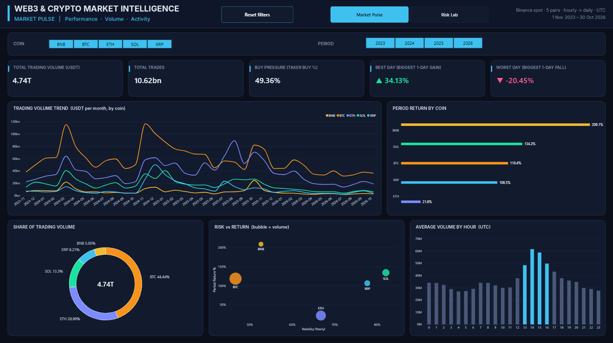
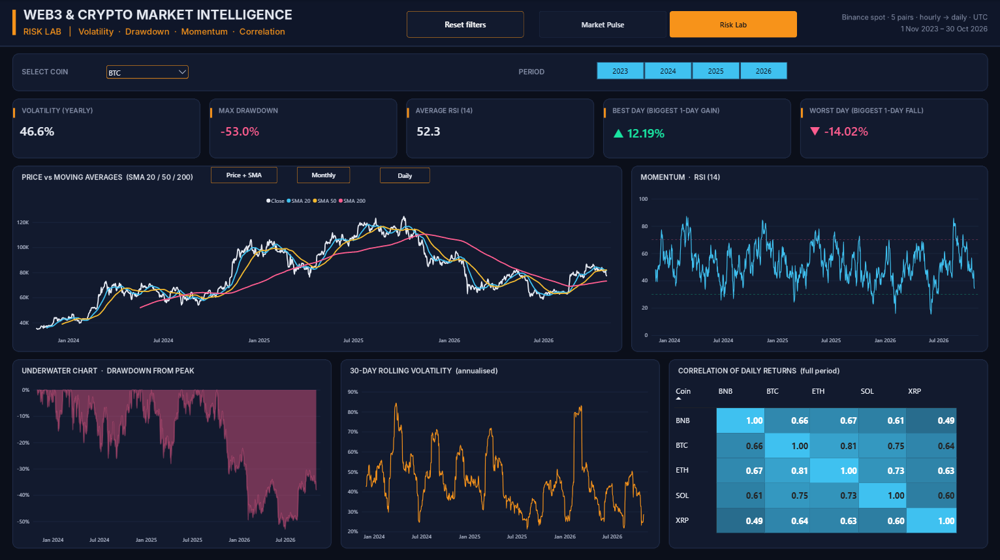

# # Capstone: Web3 & Cryptocurrency Market Intelligence and Analytics (Power BI)

Interactive two-page Power BI dashboard on **3 years of hourly Binance spot data** for BTC, ETH, SOL, BNB and XRP (1 Nov 2023 to 30 Oct 2026).

> Descriptive and diagnostic analytics only. This is not price prediction and not investment advice.

## Dashboards

| Market Pulse | Risk Lab |
| --- | --- |
|  |  |

- **Market Pulse:** trading volume trend, period return by coin, volume share, risk vs return bubble chart, average volume by hour (UTC).
- **Risk Lab:** price with SMA 20/50/200 (switchable Price / Monthly / Daily views), RSI (14), underwater (drawdown) chart, 30-day rolling volatility, correlation matrix of daily returns.
- Coin and period slicers, reset buttons (bookmarks) and a page navigator.

## Key findings

- **Volume is concentrated:** BTC (44.4%) and ETH (29.0%) make up about 73% of the 4.74T USDT traded.
- **Highest return:** BNB +209.1%, then SOL +134.2%, BTC +118.4%, XRP +106.5%, ETH +21.6% over the period.
- **Risk is not the same as return:** SOL was the most volatile (82.1% yearly volatility, max drawdown -76.3%), while BTC was the calmest (46.6%, max drawdown -53.0%).
- **Diversification is limited:** BTC and ETH daily returns have a correlation of 0.81.
- **Busiest hours:** trading volume peaks between 13:00 and 16:00 UTC.

## Data

- **Source:** [Binance Public Market Data](https://data.binance.vision/), hourly klines. 26,281 hourly rows per coin, 131,405 in total.
- **Tables used by the dashboard** (in `data/`): `fact_hourly`, `fact_daily`, `dim_coin`, `corr_matrix`, `dq_report`.
- **Data quality checks** (see `data/dq_report.csv`): 0 null cells, 0 duplicate timestamps, 0 missing hourly candles, 0 invalid OHLC rows.
- **Missing values** appear only in rolling indicators (SMA 20/50/200, RSI 14, 30-day volatility, first daily return) because they need a warm-up window. They are kept blank (`NULL`), never filled with 0, and prices are never invented.
- **Outliers** (|z-score| > 5 on hourly return) are flagged with `is_outlier`, not removed, because large moves in crypto are real events.
- **Daily table** uses complete days only (the partial last day is excluded): 1,095 days x 5 coins = 5,475 rows.

## Metrics

| Metric | Definition |
| --- | --- |
| Daily return | `close / previous close - 1` |
| Period return | `last close / first close - 1` |
| SMA N | average of the last N closes (N = 20, 50, 200) |
| RSI (14) | Wilder RSI: `100 - 100 / (1 + avg gain / avg loss)` |
| Volatility (yearly) | `std(daily return) * sqrt(365)` |
| Drawdown | `close / running peak - 1`; max drawdown is the minimum |
| Buy pressure | `taker buy quote volume / quote volume` |

Daily return, SMA, RSI, drawdown and 30-day volatility are available as columns in `fact_daily`. The KPI cards and summaries (period return, yearly volatility, max drawdown, average RSI, buy pressure, best and worst day) are DAX measures.

## Data model

Star schema: `dim_coin` and `dim_date` filter `fact_daily` and `fact_hourly`. `corr_matrix` and `dq_report` are standalone tables. The 17 DAX measures live in a `_Measures` table.

## Repository structure

```
data/                    analysis-ready CSV tables
powerbi/                 Web3_Crypto_Analytics.pbix, theme JSON, background images
docs/images/             dashboard screenshots
```

## How to open

1. Install the latest [Power BI Desktop](https://powerbi.microsoft.com/desktop/) (version 2.160 or newer; an older version may refuse to open the report).
2. Open `powerbi/Web3_Crypto_Analytics.pbix`. The data is already inside the file.
3. To refresh from the CSVs, go to Home > Transform data > Data source settings and point the sources to the `data/` folder.

To rebuild the look from scratch: import `powerbi/Web3_Dark_Neon_theme.json` (View > Themes > Browse for themes) and set each page's canvas background to the matching image in `powerbi/backgrounds/` (canvas 2560 x 1440, image fit = Fit).

## Limitations

- Only 5 coins and only Binance spot data.
- Past data analysis, not a forecast.
- RSI and SMA are indicators, not guarantees.
- Web3 ecosystem data (for example DeFi TVL) is not included yet.

## License

MIT License for the files in this repository. Market data comes from Binance Public Market Data; check Binance's terms before redistributing it.
